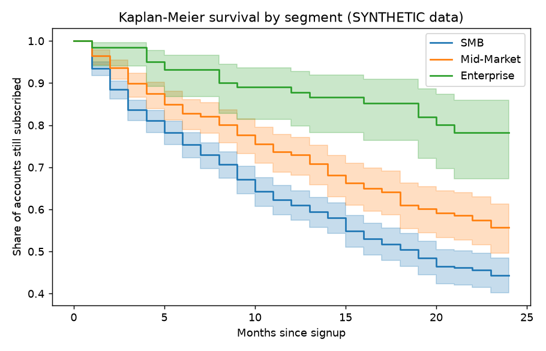

# SaaS Revenue Copilot

A governed revenue-metrics layer (ARR, CRR, NRR, GRR, consumption, churn, contraction, expansion), churn
and expansion models, a sized upgrade-flow experiment, and an LLM analyst agent that can only answer through
the metrics layer. It is evaluated against a golden question set and served behind an OAuth2/JWT API with
role-based access and a human review queue.

> **All data in this repo is SYNTHETIC.** It comes from a seeded generator (`src/copilot/data/generate.py`).
> No real company, customer or person is in it. See [What's synthetic](#whats-synthetic).

## Results

Every number below was produced by `make all` on the seed-42 dataset and printed by `scripts/results_table.py`
from the JSON in `artifacts/`. Rerun it to reproduce them.

| Component | Measure | Result | Notes |
|---|---|---|---|
| Survival (Cox PH) | Concordance index, 25% holdout | 0.739 | 1,468 accounts, 543 churn events |
| Survival (Kaplan-Meier) | 12-month survival SMB / Mid-Market / Enterprise | 61.0% / 73.0% / 87.8% | log-rank p = 1.8e-10 |
| Churn propensity (XGBoost) | AUC, time-based holdout (2025-07..11) | 0.733 | logistic baseline 0.771; top-decile lift 3.4x |
| Expansion propensity (XGBoost) | AUC, same holdout | 0.769 | logistic baseline 0.788; top-decile lift 2.9x |
| Power analysis | Accounts per arm for +20% relative MDE (alpha 0.05, power 0.8) | 20,656 | baseline upgrade rate 2.04%/month |
| A/B simulation (upgrade flow) | Empirical power / false-positive rate | 80.3% / 5.2% | 2,000 simulated tests each; one run: lift +16.2%, p = 0.023 |
| Agent, offline planner (golden 45) | Accuracy vs reference | 100.0% | metric 100.0%, refusals 100% |
| Agent, offline planner (held-out 20) | Accuracy vs reference | 100.0% | metric 100.0%, refusals 100% |
| Agent, llama3.2, one generic tool, golden | Accuracy vs reference | 57.8% | metric 52.5%; flagged 42%; unflagged accuracy 100%; wrong and unflagged: 0 |
| Agent, llama3.2, typed tools, golden | Accuracy vs reference | 64.4% | metric 60.0%; flagged 36%; unflagged accuracy 100%; wrong and unflagged: 0 |
| Agent, llama3.2, typed tools + grounding, golden | Accuracy vs reference | 82.2% | metric 80.0%; flagged 18%; unflagged accuracy 100%; wrong and unflagged: 0 |
| LLM-as-a-Judge (golden, typed tools + grounding) | Agreement with exact-match grader | 94.1% | 85 items incl. corrupted answers; caught 100% of corrupted |
| Agent, llama3.2, typed tools + grounding, held-out | Accuracy vs reference | 90.0% | metric 89.5%; flagged 10%; unflagged accuracy 100%; wrong and unflagged: 0 |
| LLM-as-a-Judge (held-out, typed tools + grounding) | Agreement with exact-match grader | 94.9% | 39 items incl. corrupted answers; caught 95% of corrupted |

Business snapshot from the semantic layer (synthetic): ARR grows from $35.0M (2024-01) to $110.1M (2025-12);
over 2025, NRR is 98.6%, GRR 82.3% and CRR 70.7%.

### How to read these results

- **The confidence gate matters most.** The local 3B model gets a lot wrong on its own. But in every LLM
  configuration, every wrong answer was caught by the confidence gate: the LLM's plan is checked against a
  deterministic planner, and any disagreement sends the answer to the review queue (**wrong and unflagged: 0**).
  So the answers that went out unreviewed were 100% correct; the cost is how many get reviewed (10-42%).
- **The agent eval improved through two changes, each measured.** One generic tool scored 52.5% on metric
  questions. Three typed tools with enum parameters raised that to 60.0%. A grounding guardrail, which drops a
  segment filter the question never mentions (the 3B model kept adding "Enterprise"), raised it to 80.0%.
  On the 20-question held-out set, written after these changes and never used to tune them, it scored 89.5%.
- **XGBoost loses to logistic regression on this data, and the table says so.** The generator's churn
  process is linear in the logit, so a linear model fits it best. On real data with interactions the order
  could flip. The baseline is there so that question is always asked.
- **The offline planner's 100% is close to in-sample.** I wrote its patterns while looking at the golden set.
  The held-out set uses new phrasing, but I wrote it too. Read this number as "the no-key mode works", not as
  a generalization claim. The LLM rows are the real test of language understanding.
- **The judge prompt was revised once, on the golden set.** It now shows the reference in the same format as
  the agent's answer. Before that change, agreement on the same golden runs was 80.0-84.7%. The judge is
  scored against an exact-match grader on a balanced set: the agent's real answers plus one corrupted answer
  (value shifted ±15%) per metric question. Without the corrupted answers, a judge that always says CORRECT
  would look perfect.
- The LLM runs use Ollama `llama3.2` (3B) at temperature 0. A different Ollama build or model version can
  move these numbers by a question or two.



Cox hazard ratios (from `artifacts/survival/cox_summary.csv`): more API calls per user in the first two months
(HR 0.21 per log unit, p < 0.001) and the Enterprise segment (HR 0.38, p = 0.014) are linked to much lower churn
hazard.

## Architecture

```
                 ┌────────────────────────── FastAPI service ───────────────────────────┐
  client ──JWT──▶│ /auth/token (OAuth2 password → JWT)   RBAC: viewer < admin             │
                 │ middleware: request id, JSON logs (PII redacted), Prometheus counters  │
                 │ /v1/ask ──▶ LangGraph agent ──▶ confidence < 0.7 ? ──▶ review queue    │
                 │ /v1/answers/{id}/flag (viewer)   /v1/reviews/{id}/resolve (admin)      │
                 └──────────────┬──────────────────────────────────────┬─────────────────┘
                                │ typed tool calls only                 │ SQLite audit log
                 ┌──────────────▼──────────────┐                        ▼
                 │ Semantic layer (DuckDB SQL) │◀── cross-checked by ── pandas reference impl
                 │ ARR MRR CRR NRR GRR churn   │                        (also grades the agent)
                 │ expansion contraction usage │
                 └──────────────┬──────────────┘
                                │
     SYNTHETIC generator ──▶ accounts · subscriptions_monthly · plan_changes · usage_monthly
                                │
                 survival (lifelines) · XGBoost propensity · power analysis + A/B sim ──▶ MLflow
```

**Agent graph** (`src/copilot/agent/graph.py`): `plan → (call_tool | refuse) → answer`.

- **plan.** The `offline` backend uses a deterministic planner and needs no key and no LLM. The `ollama`
  backend asks a local model for a tool call; the deterministic planner runs too, as a second opinion.
- **Guardrails.** Requests for names, emails, account IDs, raw rows or SQL writes are refused before any model
  sees them. The model never writes SQL. Tool parameters are typed and validated (month format, segment enum,
  metric enum), and segment values reach SQL as bound parameters. Tools return aggregates only.
- **answer.** The number in the answer always comes from the tool result, never from the model's text, so
  the model cannot invent a figure.

**Metric definitions** are in the docstring of `src/copilot/metrics/semantic.py`. CRR = (E − N) / S;
NRR = end MRR of the start cohort / start MRR; GRR caps each account at its start MRR. Every SQL metric is
checked against the independent pandas implementation across 276 metric/month/segment combinations
(`tests/test_metrics.py`).

## How to run

```bash
make setup        # uv venv + editable install (macOS: XGBoost needs `brew install libomp`)
make data         # SYNTHETIC data -> data/saas.duckdb
make models       # survival, propensity, experiment -> MLflow (sqlite:///mlflow.db) + artifacts/
make golden       # golden + held-out sets, answers from the pandas reference implementation
make eval         # agent eval, offline backend: no API key, no LLM
make test         # 43 tests: metrics, generator, models, agent, API
make mlflow       # browse runs at http://127.0.0.1:5000
```

**With a local LLM, still no API key:** `ollama pull llama3.2`, then `make eval-llm`.

**API:** copy `.env.example` to `.env`, set real values, export them, then `make serve`:

```bash
TOKEN=$(curl -s -X POST localhost:8000/auth/token -d 'username=viewer&password=...' | jq -r .access_token)
curl -s -X POST localhost:8000/v1/ask -H "Authorization: Bearer $TOKEN" \
     -H 'content-type: application/json' -d '{"question": "What was Enterprise NRR over 2025?"}'
# {"answer": "nrr for Enterprise, 2024-12 to 2025-12: 99.60%.", "confidence": 1.0, "flagged": false, ...}
```

CI (`.github/workflows/ci.yml`) generates the data, runs the tests, trains the models and runs the offline
agent eval on every push.

## What's synthetic

All of it. The generator simulates 24 months (2024-01 to 2025-12) of a seat-based B2B SaaS business: 1,468
accounts, 17,211 monthly subscription snapshots, 3,199 plan changes and 17,754 account-months of usage
(API calls, active users, feature events, support tickets). Each account has a hidden "engagement" random
walk. Low engagement, low seat utilization and support tickets raise the monthly churn hazard. High
utilization drives seat expansion, and high engagement drives plan upgrades. Because the process is known,
the models can be checked against it. That same fact flatters them: real churn is noisier. Account names are
`SYNTH-00001` and so on.

Why synthetic: NRR, GRR, contraction and consumption need month-by-month plan-change and usage history
per account, and a seeded generator gives a known ground truth to test the models against. Swapping in real
data means loading the same four tables; the semantic layer, models and agent don't change.

## Layout

```
src/copilot/data/generate.py      seeded SYNTHETIC generator
src/copilot/metrics/semantic.py   DuckDB semantic layer (the only data path for the agent)
src/copilot/metrics/reference.py  independent pandas implementation (tests + golden answers)
src/copilot/models/               features, survival, propensity, experiment, run_all (MLflow)
src/copilot/agent/                planner, LangGraph agent, golden sets, evaluator + LLM judge
src/copilot/api/                  FastAPI app, OAuth2/JWT + RBAC, SQLite audit + review store
eval/                             golden_set.jsonl (45), holdout_set.jsonl (20)
artifacts/                        results.json, eval_*.json, KM plot, Cox summary
```
